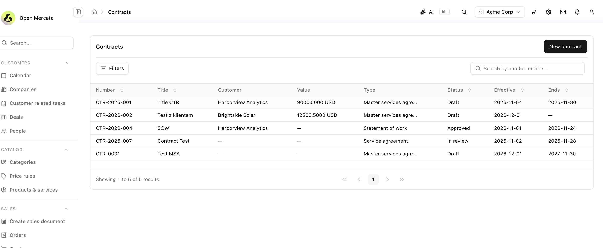
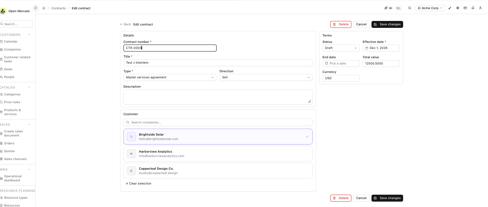

# Contracts (CLM) module for Open Mercato — Phase 1 prototype

A Contract Lifecycle Management module built as a standalone Open Mercato app (`create-mercato-app` 0.10.0, `classic` preset). It is a proof of concept to learn the framework's conventions and to start a conversation about CLM — **not** an official module.

Feature discussion upstream: https://github.com/open-mercato/open-mercato/issues/8979

Built in spare time on personal hardware, from public knowledge about CLM. No employer or customer material, configuration or data is included.

## What works today

- Contract list at `/backend/contracts` with search (number, title), filters (status, type), server-side sorting and pagination
- Create, edit and delete (optimistic locking through `updatedAt`)
- Customer picker backed by `GET /api/customers/companies`; the server stores a frozen `customer_snapshot` when the customer is set or changed
- Total value with currency (decimal string, `numeric(18,4)`)
- English and Polish translations (`i18n/en.json`, `i18n/pl.json`)
- ACL features `contracts.contracts.view` and `contracts.contracts.manage`

## Screenshots

| | |
|---|---|
| List (EN) |  |
| Create with customer picker |  |
| Edit |  |

## Design decisions

- **Contract dates are calendar days.** `effective_date` and `end_date` are `date` columns and travel as `yyyy-MM-dd` strings, so no time zone can shift them (the same bug class as upstream issue #8968). Verified end to end: the day picked in the UI is the day stored.
- **No ORM relation across modules.** The customer is stored as `customer_entity_id` plus a `customer_snapshot` with the same shape the `sales` module uses (`{ customer: { id, kind, displayName, primaryEmail, primaryPhone, companyProfile } }`). Renaming a company in the CRM does not rewrite signed contracts.
- **The server builds the snapshot** (`hooks.beforeCreate` on create; on update only when the customer changes). The client never supplies it.
- **Amounts are strings**, to keep `numeric(18,4)` precision.
- **CRUD through `makeCrudRoute`** at `/api/contracts/contracts`, with OpenAPI metadata.

## Not done yet

Commands with audit and undo, automated tests, workflow-driven statuses, expiry and renewal reminders, templates and clause library, e-signature, procurement-side contracts. Planned phases are described in the upstream discussion.

## Module layout

```
src/modules/contracts/
  index.ts, acl.ts, setup.ts
  data/entities.ts, data/validators.ts
  migrations/
  api/contracts/route.ts, api/openapi.ts
  backend/contracts/            list, create, [id]/edit pages
  components/                   ContractsTable.tsx, ContractForm.tsx
  i18n/                         en.json, pl.json
```

## Run locally

Prerequisites: Node, Yarn and Docker.

```bash
docker compose up -d     # postgres, redis, meilisearch
yarn install
yarn setup
yarn dev
```

Open http://localhost:3000/backend. The framework's demo seed creates `superadmin@acme.com`; use the credentials printed by `yarn setup` or documented by Open Mercato. These are local demo credentials only. Never commit `.env`.

## Feedback

Questions for the Open Mercato team are in the upstream issue: official module vs partner-maintained extension, whether a procurement module is planned, and which conventions to follow.
